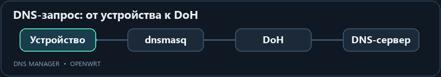
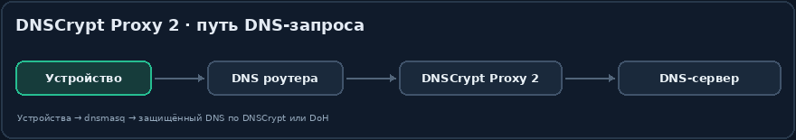
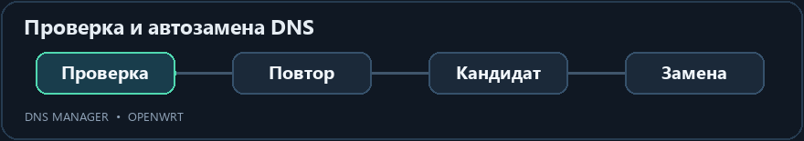
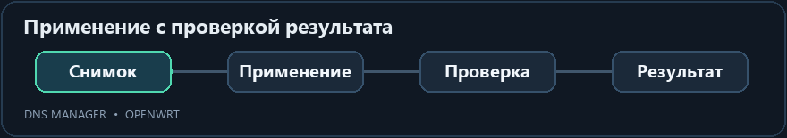

<div align="center">

# DNS Manager

**Управление защищённым DNS на роутере OpenWrt через LuCI**


[](https://openwrt.org/)
[](#вкладки-dns-manager)
[](#движки-и-серверы)
[](#движки-и-серверы)
[](LICENSE)

[](https://github.com/PoTuStoronu222/DNS-Manager/stargazers)
[](https://gitviews.com/)
[](https://github.com/PoTuStoronu222/DNS-Manager/commits/main)

</div>

DNS Manager помогает настроить защищённый DNS для устройств домашней сети через привычный интерфейс OpenWrt. Выбирайте DNS-серверы, проверяйте их доступность и управляйте настройками прямо в LuCI.

**[Установка](#установка)** · **[Движки](#движки-и-серверы)** · **[Возможности](#вкладки-dns-manager)** · **[Проверка DNS](#проверка-и-региональные-настройки)** · **[Диагностика](#диагностика)**

### Что умеет DNS Manager

- **Два движка** — HTTPS DNS Proxy и DNSCrypt Proxy 2 устанавливаются по мере выбора.
- **Каталог DNS** — категории, проверка серверов и ручной выбор подходящего набора.
- **Профили и устройства** — подбор DNS по назначению; в HTTPS DNS Proxy доступны отдельные слоты и привязки устройств.
- **Контроль и восстановление** — периодическая проверка DNS и фоновые операции, которые продолжаются после ухода со страницы.
- **Настройки сети** — принудительный DNS, параметры кэша и отдельный выбор DNS для российских сайтов и сайтов СНГ.

> При смене движка профили, слоты и привязки сбрасываются. Перед применением LuCI покажет предупреждение.

## Установка


Подключитесь к роутеру по SSH:

```sh
wget -O /tmp/dns-manager-luci.sh https://raw.githubusercontent.com/PoTuStoronu222/DNS-Manager/main/dns-manager-luci.sh && DNS_MANAGER_SOURCE_REF=main sh /tmp/dns-manager-luci.sh install
```

При первом переходе со старой версии запустите эту же команду установки поверх существующей. Она обновляет backend и LuCI, переносит проверку DNS на cron и не выбирает новый DNS-профиль. Старый обновлятор LuCI может не скачать новый установщик из-за ограничения размера файла, поэтому для первого перехода используйте SSH-команду выше.
Поддерживаются пакетные менеджеры `apk` и `opkg`. После установки откройте **LuCI → Службы → DNS Manager**, выберите движок и настройте DNS. Профиль автоматически не применяется.

## Движки и серверы



На схеме показан путь запроса через DoH. Устройства обращаются к DNS роутера; dnsmasq передаёт запросы выбранной защищённой DNS-службе. В режиме DNSCrypt Proxy 2 соединение с сервером может использовать протокол DNSCrypt или DoH.

| | HTTPS DNS Proxy | DNSCrypt Proxy 2 |
|---|---|---|
| **Протоколы** | DNS over HTTPS | DNSCrypt и DNS over HTTPS |
| **Серверы** | До шести отдельных слотов | Общий набор до шести серверов |
| **Выбор устройства** | Привязка к отдельному слоту | Общий набор для роутера |
| **Выбор сервера** | Настройки слотов и профили | Штатные стратегии DNSCrypt и профили |

- **HTTPS DNS Proxy** использует DNS over HTTPS (DoH). Поддерживает до шести слотов и привязку устройств к слотам.
- **DNSCrypt Proxy 2** использует один процесс и общий набор серверов. Он поддерживает как протокол DNSCrypt, так и DoH. В настройках можно выбрать протокол, стратегию выбора и вручную собрать набор до шести серверов. Очерёдность в списке сама по себе не задаёт приоритет.

**Как проходит запрос в DNSCrypt Proxy 2**



DNS роутера принимает запрос, а DNSCrypt Proxy 2 автоматически выбирает доступный сервер из набора согласно выбранной стратегии. Между прокси и сервером используется DNSCrypt или DoH. Привязка устройств к отдельным слотам доступна в режиме HTTPS DNS Proxy.

В каталоге можно выбрать протокол и категорию, проверить отдельный сервер или выбранную группу и добавить серверы в набор. Групповую проверку можно остановить. В разделе «Все DNS» доступен фильтр по стране; варианты одного провайдера собраны вместе. Для DNSCrypt используются записи из [официального каталога публичных резолверов](https://github.com/DNSCrypt/dnscrypt-resolvers/blob/master/v3/public-resolvers.md), подпись которого проверяет dnscrypt-proxy. Наличие сервера в каталоге не гарантирует его доступность в конкретной сети.

Профили подбирают доступные серверы по назначению: без фильтрации, защита от угроз, конфиденциальность, блокировка рекламы, семейная фильтрация, DNSSEC или обход геоблокировок. Набор зависит от выбранного протокола и результатов проверки. DNS Manager работает на уровне DNS и не заменяет VPN или средства обхода DPI.

## Вкладки DNS Manager

| Вкладка | Возможности |
|---|---|
| **Обзор** | Состояние системы, DNS и компонентов, проверка версий и обновление. |
| **Защищённый DNS** | Выбор движка, профиля и DNS для российских сайтов и сайтов СНГ. |
| **DNS по слотам / DNS-серверы** | Настройка отдельных DoH-слотов либо общего набора DNSCrypt. |
| **Устройства** | Привязка устройств к DoH-слотам в режиме HTTPS DNS Proxy. |
| **Сеть** | Проверка DNS, принудительный DNS, кэш и другие сетевые настройки. |
| **Время** | Выбор серверов системного времени. |
| **Каталог DNS** | Категории, поиск серверов, проверка и ручной выбор. |
| **Журнал** | События и ошибки DNS Manager. |

## Проверка и региональные настройки



На схеме показан пример автозамены в режиме HTTPS DNS Proxy.

В HTTPS DNS Proxy можно включить периодическую проверку слотов и автозамену. В DNSCrypt Proxy 2 за выбор доступного сервера из текущего набора отвечает сам DNSCrypt; проверка показывает состояние DNS и не меняет профиль при общем сбое. Периодические проверки выполняются через cron.

При зависании DNSCrypt проверка может перезапустить службу, сохраняя выбранный профиль; при общем сбое сети перезапуск откладывается.

Для российских сайтов и сайтов СНГ можно выбрать общие защищённые DNS, Яндекс DNS или DNS провайдера. Смена профиля не меняет этот выбор. Принудительный DNS направляет обычные запросы устройств к DNS роутера; при использовании Steer результат зависит также от его правил.

Региональный режим охватывает зоны `.ru`, `.su`, `.рф`, `.by`, `.kz` и отдельные домены, используемые российскими сервисами и маркетплейсами. Режимы Яндекс DNS и DNS провайдера отправляют эти запросы напрямую, без защищённого DNS-движка.

Длительные действия выполняются в фоне: переход со страницы не должен прерывать запущенную операцию. Состояние можно посмотреть после возвращения в LuCI.

## Bootstrap DNS


На схеме показано подключение по DoH. Bootstrap DNS помогает определить адрес защищённого DNS-сервера до подключения к нему. Для HTTPS DNS Proxy можно выбрать готовые наборы или добавить собственные IP-адреса. Начальный запрос к bootstrap-серверу не шифруется как DoH.

Для DNSCrypt Proxy 2 в LuCI также доступны выбор протокола и штатной стратегии выбора серверов, настройки сети и кэша. В режиме «Только DNSCrypt» используются серверы протокола DNSCrypt; DoH-серверы можно просматривать в каталоге, но нельзя добавить в такой набор.

## Принудительный DNS

Принудительный DNS направляет обычные DNS-запросы устройств на DNS роутера. Настройка ограничения обхода дополнительно блокирует исходящий DoT на порту 853, но не гарантирует блокировку произвольного DoH через HTTPS. Отдельная настройка может предложить поддерживающим её браузерам и устройствам использовать DNS роутера.

При совместном использовании со Steer маршрут DNS зависит от его правил и выбранного режима. Шифрование DNS не означает, что запросы автоматически проходят через VPN.

## Восстановление и удаление



Схема иллюстрирует общий ход применения; действия восстановления зависят от выбранной операции.

Кнопки восстановления стандартного DNS и удаления DNS Manager находятся в интерфейсе. При смене движка и сбросе внимательно читайте предупреждения: выбранные профили и привязки могут быть удалены.

## Диагностика

```sh
nslookup example.com 127.0.0.1
logread -e dns-manager
```

В режиме DNSCrypt локальный прокси использует порт `5053`, а устройства обращаются к `dnsmasq` на порту `53`.

---

## Лицензия и безопасность

DNS Manager распространяется на условиях [Apache License 2.0](LICENSE). Автор — **PoTuStoronu222**; уведомление об авторстве находится в [NOTICE](NOTICE).

Об уязвимостях можно сообщить приватно через GitHub. Порядок описан в [политике безопасности](SECURITY.md).

<div align="center">
  <sub>DNS Manager · OpenWrt · LuCI</sub>
</div>
