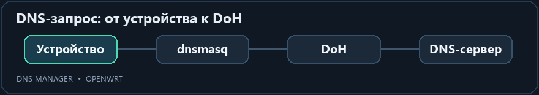
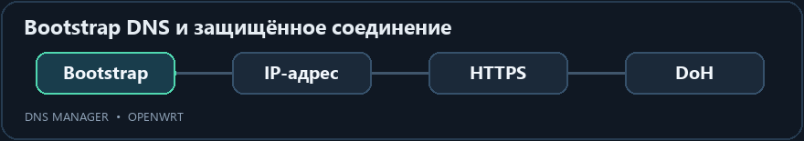
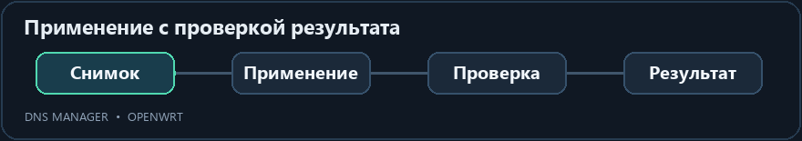

<div align="center">

# DNS Manager

**Управление DNS over HTTPS на роутере OpenWrt через LuCI**


[](https://openwrt.org/)
[](#вкладки-dns-manager)
[](#как-работает-dns-manager)

[](https://github.com/PoTuStoronu222/DNS-Manager/stargazers)
[](https://gitviews.com/)
[](https://github.com/PoTuStoronu222/DNS-Manager/commits/main)

</div>

DNS Manager настраивает DNS-серверы и DNS over HTTPS (DoH) для устройств домашней сети. В панели можно выбрать профиль, проверить серверы, назначить DNS отдельным устройствам и включить автоматическое восстановление.

## Установка


Подключитесь к роутеру по SSH и выполните:

```sh
wget -O /tmp/dns-manager-luci.sh https://raw.githubusercontent.com/PoTuStoronu222/DNS-Manager/main/dns-manager-luci.sh && sh /tmp/dns-manager-luci.sh install
```

Установщик проверит и при необходимости установит LuCI и зависимости, включая `https-dns-proxy`. Поддерживаются пакетные менеджеры `apk` и `opkg`. DNS-профиль автоматически не применяется.

Откройте **LuCI → Службы → DNS Manager**, затем выберите и примените профиль DNS. SSH понадобится для установки и при необходимости для диагностики.

## Как работает DNS Manager



В обычной схеме устройства обращаются к DNS роутера. `dnsmasq` принимает запросы, а `https-dns-proxy` отправляет их выбранным DoH-серверам. DNS Manager настраивает эти компоненты; отдельный веб-сервер ему не нужен.

В каталоге доступны категории: обход геоблока, без фильтрации, защита от угроз, конфиденциальность, блокировка рекламы, семейная фильтрация, игровые и региональные DNS. Возможности конкретного сервера зависят от его провайдера и доступности в вашей сети.

DNS Manager работает на уровне DNS. Он не заменяет VPN, прокси или инструменты обхода DPI и не гарантирует доступ ко всем ресурсам.

## Вкладки DNS Manager

| Вкладка | Что можно сделать |
|---|---|
| **Дашборд** | Посмотреть состояние роутера и DNS, проверить текущие серверы, обновить компоненты. |
| **DNS over HTTPS** | Выбрать профиль и режим российских зон, настроить bootstrap, принудительный DNS и ограничение обхода. Восстановить DNS или удалить менеджер. |
| **DNS по слотам** | Назначить серверы в слоты 1–6 и указать домены, которые должны обрабатываться через конкретный слот. |
| **Устройства LAN** | Привязать устройство к выбранным DoH-слотам. Для устройств без привязки используется обычная схема DNS роутера. |
| **Сеть** | Включить проверку DNS и автозамену, настроить их параметры и увеличить кэш dnsmasq. |
| **Серверы точного времени** | Выбрать серверы времени для системного NTP. |
| **Каталог DNS** | Проверить отдельный сервер или весь каталог, выбрать категорию и добавить собственный DoH. |
| **Журнал** | Посмотреть ошибки, восстановление, замену DNS и другие события менеджера. |

## Проверка DNS и автозамена


**Проверка DNS** и **автозамена** включаются отдельно на вкладке «Сеть». Проверка регулярно опрашивает назначенные DoH-слоты. По умолчанию интервал — две минуты, порог отказа — две последовательные проверки; их можно изменить.

Если автозамена включена и DNS не удалось восстановить, менеджер ищет кандидата в той же категории и проверяет его перед применением. При отсутствии свежих результатов проверяется категория. Если кандидата подтвердить не удалось или состояние сети неопределённо, выбранный DNS сохраняется. Пользовательские DoH автоматически не заменяются. При ошибке применения выполняется откат, где это возможно.

Проверка отдельного DoH обращается к его адресу и проверяет ответ; время ответа помогает сравнить серверы. Результаты фоновой проверки обновляют записи проверенных серверов и не считаются проверкой всего каталога.

## Российские сайты

В **DNS over HTTPS → Профили DNS** для зон `.ru`, `.su` и `.рф` доступны три режима:

- **Через DoH** — используются общие DoH-серверы.
- **Яндекс DNS** — запросы этих зон направляются на Яндекс DNS без DoH.
- **DNS провайдера** — запросы этих зон направляются на DNS провайдера без DoH; при смене адресов они обновляются.

Смена профиля не меняет выбранный режим. Региональный DoH из старой конфигурации сохраняется до выбора нового режима. Правила Steer для отдельных доменов могут обрабатывать запросы до dnsmasq.

## Bootstrap DNS



Bootstrap DNS определяет IP-адрес DoH-сервера до подключения к нему. Можно выбрать и объединить готовые наборы или добавить собственные IP-адреса. Начальные запросы к bootstrap-серверу не шифруются как DoH. Настройка bootstrap не меняет выбранный профиль DNS.

## Принудительный DNS

Принудительный DNS направляет обычные DNS-запросы устройств на роутер. Если активный перехват выполняет Steer, DNS Manager учитывает его и не создаёт второй такой перехват.

Настройка **«Не давать устройствам обходить блокировку»** ограничивает исходящий DoT на порту 853. Она не гарантирует блокировку произвольного DoH через HTTPS/443. Работа других механизмов зависит от настроек сети и устройств.

## Применение и восстановление



При применении DNS Manager сохраняет необходимые настройки и проверяет результат. Если применение завершилось ошибкой, менеджер пытается восстановить предыдущую конфигурацию. Изменяющие операции защищены от одновременного выполнения.

Кнопка **«Восстановить стандартную настройку DNS»** находится в **DNS over HTTPS → Профили DNS**. Сторонние настройки и правила учитываются при восстановлении; результат зависит от текущей конфигурации роутера.

## Удаление

Откройте **LuCI → Службы → DNS Manager → DNS over HTTPS** и нажмите **«Удалить DNS Manager»**. Менеджер отключит свои функции, уберёт созданные им привязки и настройки, восстановит обычный DNS-путь и удалит свои файлы. Пакеты, установленные менеджером, удаляются, если они больше не нужны другим DNS-конфигурациям.

Сторонние обнаруженные DNS-секции и правила сохраняются. Старые версии не сохраняли все прежние настройки, поэтому уже удалённые ранее сторонние DNS-секции автоматически восстановить нельзя.

## Диагностика по SSH

```sh
# DNS роутера
nslookup example.com 127.0.0.1

# Пример проверки DoH-слота на локальном порту 5053
dig @127.0.0.1 -p 5053 example.com A +short

# Состояние принудительного DNS
/usr/bin/dns-manager --force-state

# Фоновые события DNS Manager
logread -e dns-manager
```

Порт `5053` указан для примера: фактический порт слота можно посмотреть в LuCI. Если команда `dig` отсутствует, её нужно установить средствами OpenWrt.
